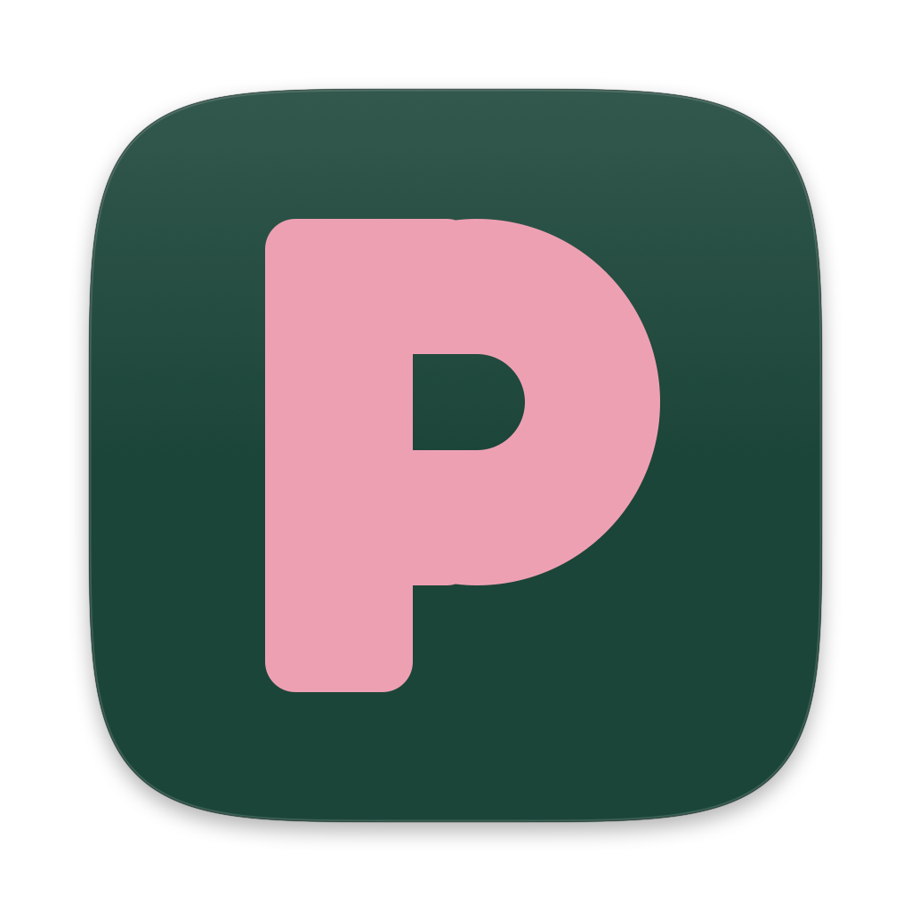
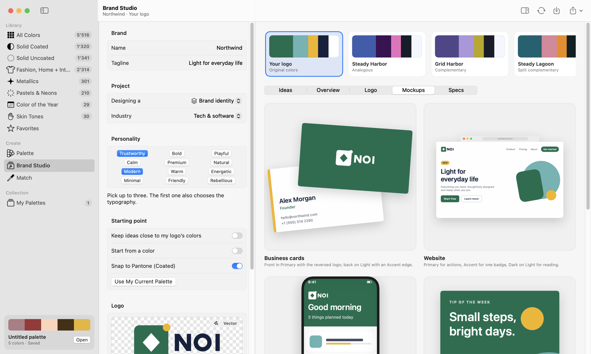
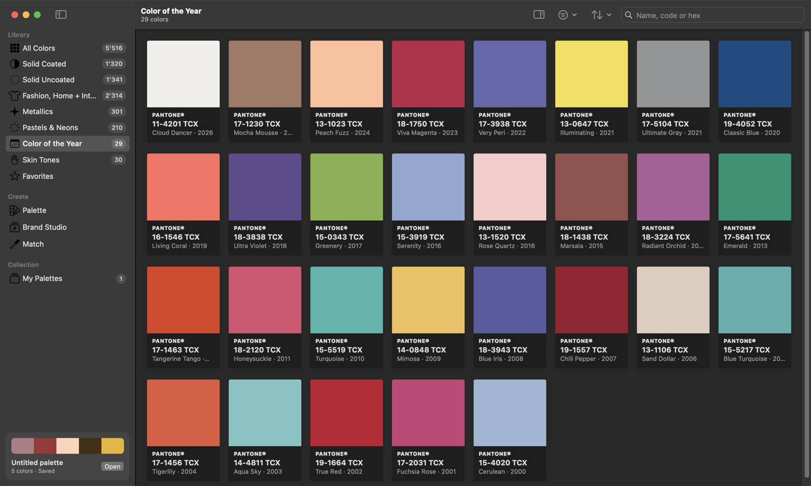
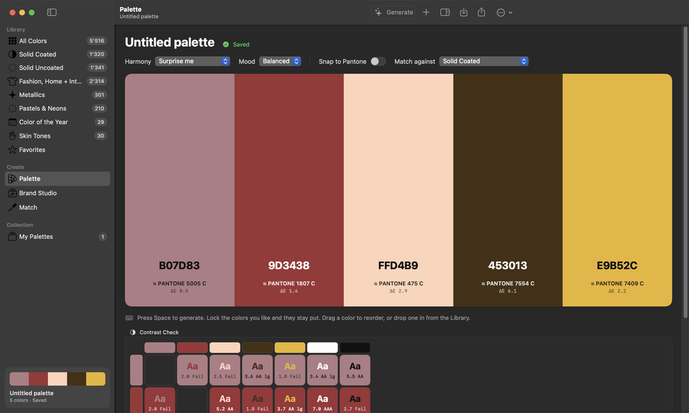
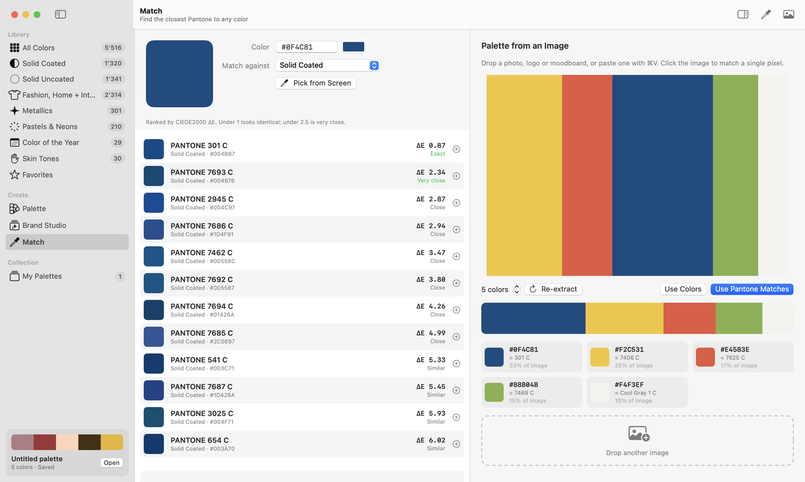

<p align="center">
  
</p>

<h1 align="center">Palette Pro</h1>

<p align="center">
  Color and type palettes for designers: a Pantone-style color library, palette generator,<br>
  brand studio, color matcher, and a free font library with pairing ideas and type scales.<br>
  A native macOS app built with SwiftUI, plus a web version that runs in any browser.
</p>

<p align="center">
  <a href="../../releases/latest"><b>⬇︎ Download for Mac</b></a>
  &nbsp;·&nbsp;
  <a href="https://jovankucinovski-ops.github.io/Palette-Pro/"><b>Open the web app</b></a>
  &nbsp;·&nbsp;
  <a href="#build-from-source">Build from source</a>
</p>

<p align="center">
  
</p>

## Features

- **Library**: 5,500+ Pantone-style swatches: Solid Coated and Uncoated, Fashion, Home + Interiors (TCX), Metallics, Pastels & Neons, Skin Tones and every Color of the Year from 2000 to 2026. Search by name, code or hex; a hex such as `#0F4C81` lists the closest matches.
- **Palette editor**: press `Space` to generate palettes by harmony and mood, lock the colors you like, see the nearest Pantone and ΔE for every color, snap a palette to Pantone, and check WCAG contrast for every text and background pair.
- **Brand Studio**: enter a brand name or drop in your logo (SVG or PNG) and get 12 color ideas with the logo recolored in each one. Every idea comes with color roles, usage guidance, type pairings, logo variants, mockups (cards, website, app, social, packaging, letterhead), print and UI specs, a one-page **brand sheet PDF** and a **logo package**.
- **Fusion**: press `Space` for colors and fonts that work together, shown on a website, poster or app screen. Lock what you like, choose a mood and light, dark or colored pages; every combination is checked for readable contrast.
- **Fonts**: 1,500+ free fonts from Google Fonts, [Fontshare](https://www.fontshare.com) and independent open-source foundries, plus the fonts on your Mac. Includes **Designer Picks** (Satoshi, Clash Display, General Sans, Fraunces, Instrument Serif and more), filters by style, your own preview text, every weight, the character set and the license. Fonts download only when you preview them.
- **Pairing**: 12 heading and body combinations with a reason for each. Explore, or start from a font you like, and choose a mood (editorial, modern, elegant, friendly, corporate, bold). Double-click a pairing for a full magazine-style page preview.
- **Type Scale**: every text size from one base size and ratio, with line heights and letter spacing, previewed with your fonts. Export as CSS variables, SCSS, Tailwind, SwiftUI or design tokens (JSON).
- **Match**: find the nearest Pantones to any color (CIEDE2000), pick a color from anywhere on screen, or extract a palette from a photo.
- **Export**: CSS variables, SCSS, Tailwind v3/v4, SwiftUI, JSON, hex list, GIMP/Inkscape `.gpl`, Adobe `.ase`, Apple `.clr` and PNG. **Add to macOS Colors** puts a palette in the system color picker of every Mac app.
- **Private**: works offline with no account. Your palettes stay on your Mac or in your browser.

| Library | Palette editor | Match |
| --- | --- | --- |
|  |  |  |

## Install on a Mac

Requires **macOS 14 Sonoma or later** on an Apple silicon Mac. On an Intel Mac, [build it from source](#build-from-source).

1. Download **Palette-Pro-x.y.dmg** from the [latest release](../../releases/latest).
2. Open it and drag **Palette Pro** onto **Applications**.
3. The first time you open it, macOS asks because the app isn't notarized by Apple (that needs a paid developer account). Open it once, then go to **System Settings › Privacy & Security** and click **Open Anyway**. On macOS 14 you can instead right-click the app and choose **Open**.

   If you prefer the Terminal:

   ```bash
   xattr -dr com.apple.quarantine "/Applications/Palette Pro.app"
   ```

The release also has a `.zip` of the app if you'd rather not use the disk image.

## Web app

- **Online:** [jovankucinovski-ops.github.io/Palette-Pro](https://jovankucinovski-ops.github.io/Palette-Pro/). Nothing to install, and palettes are saved in your browser. It has the Library, Palette, Match, Fonts, Pairing and Type scale sections (Brand Studio is Mac only).
- **Offline:** download **Palette-Pro-x.y-web.zip** from the [latest release](../../releases/latest), unzip it and double-click `index.html`.

It works in Chrome, Edge, Safari and Firefox. Backups move freely between the web and Mac versions. See [web-app/README.md](web-app/README.md).

## Build from source

You need macOS 14 or later and either Xcode or just the Command Line Tools (`xcode-select --install`). There are no third-party dependencies.

```bash
git clone https://github.com/jovankucinovski-ops/Palette-Pro.git
cd Palette-Pro
mac-app/scripts/build-app.sh --install
```

This builds `Palette Pro.app` and installs it in `~/Applications`. Build files go to `~/Library/Caches/PalettePro-build`, outside the project folder. To make a disk image for another Mac, run:

```bash
mac-app/scripts/make-dmg.sh
```

More detail, including keyboard shortcuts and where data is stored, is in [mac-app/README.md](mac-app/README.md).

## Project layout

```
mac-app/                 native macOS app (Swift Package, SwiftUI)
  Sources/PalettePro/    App, Model, Views, Brand
  scripts/               build-app.sh, make-dmg.sh, make-icon.swift, update-fonts.py
  Resources/             Info.plist, app icon preview
web-app/                 browser version (plain HTML, CSS and JavaScript, no build step)
docs/screenshots/        images used in this README
.github/workflows/       release builds and GitHub Pages
```

## Releases

Releases are built automatically by GitHub Actions. To publish a new version:

1. Update `CFBundleShortVersionString` (and `CFBundleVersion`) in `mac-app/Resources/Info.plist`.
2. Commit, then tag and push:

   ```bash
   git tag v1.1
   git push origin v1.1
   ```

The [Release workflow](.github/workflows/release.yml) builds the app, packages the DMG, a zip of the app and a zip of the web app, and publishes them on the Releases page with SHA-256 checksums. The [Web app workflow](.github/workflows/pages.yml) publishes `web-app/` to GitHub Pages on every push to `main`.

## Color data and trademarks

PANTONE® and other Pantone trademarks are the property of Pantone LLC. Palette Pro is an independent project and is not affiliated with, sponsored or endorsed by Pantone.

The hex values are screen approximations collected from public sources: [bconglet/Pantoner](https://github.com/bconglet/Pantoner) (MIT) and [Margaret2/pantone-colors](https://github.com/Margaret2/pantone-colors), plus published Color of the Year values. They're meant for digital design and reference. For print, approve colors against a physical Pantone guide. CMYK values are simple conversions, not a press profile.

## Fonts

Palette Pro bundles only a catalogue of font names and details, not the fonts themselves. A font file is downloaded from its official source the first time you preview it ([Fontsource](https://fontsource.org)'s CDN for Google Fonts and open-source families, Fontshare's CDN for Fontshare fonts). It's cached in `~/Library/Caches/Palette Pro/Fonts` and used only inside the app; nothing is installed on your Mac. **Get Font** opens the official page where you can download the full family.

Google Fonts and the open-source families use the SIL Open Font License or similar licenses. Fontshare fonts use the ITF Free Font License. Both are free for personal and commercial use. To refresh the catalogue, run `python3 mac-app/scripts/update-fonts.py`.

## License

The source code is released under the [MIT License](LICENSE). The color data files (`web-app/js/data.js` and `mac-app/Sources/PalettePro/Model/SwatchData.swift`) come from the third-party sources above and are not covered by that license.

Issues and pull requests are welcome.
